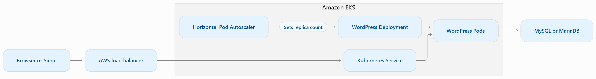
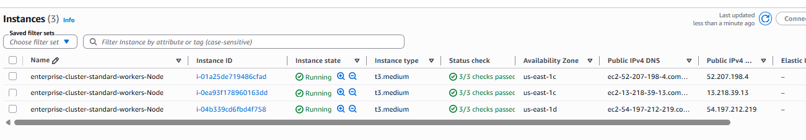
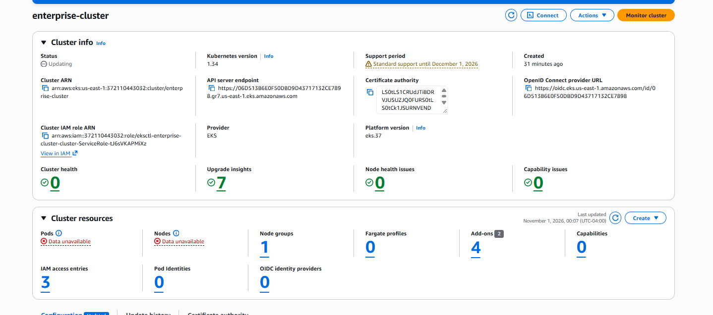

# AWS-EKS-Cluster-WordPress-Deployment

I built this lab to practice deploying a containerized application on Amazon EKS, exposing it through an AWS load balancer, and setting up a CPU-based autoscaling test. WordPress is the sample workload. I used `eksctl` to provision the cluster, Helm to manage the application release, and `kubectl` to verify the deployment.

## Architecture



The diagram shows the intended setup. A functional WordPress installation requires a reachable MySQL or MariaDB database. The lab configuration also uses two independent scaling ranges: **3–6 worker nodes** for the managed node group and **1–5 application Pods** for the HPA. The node group bounds alone do not enable node autoscaling.

## Prerequisites

- An AWS account with credentials authorized to create EKS and its supporting resources.
- AWS CLI, `eksctl`, `kubectl`, and Helm 3. The examples use Bash or Git Bash.
- A reachable database for a functional WordPress site and a working Kubernetes resource metrics API for the CPU-based scaling test.
- The local Helm chart in `my-microservice/` and the HPA manifest in `hpa.yaml`.

## Tools

- **Helm** - The package manager for Kubernetes. Combines the templates with your values to generate Kubernetes YAML and submits it to the Kubernetes API.
- **Chart** - A template for Kubernetes resources
- **Value** - The number and value for the configuration
- **Kubernetes** - Takes the YAML file and builds out the resources, including running the pods

## Install AWS CLI and eksctl 

Installing the required tools (AWS CLI & `eksctl`) to start the project.

```bash
aws --version
```

```bash
curl --silent --location "https://github.com/weaveworks/eksctl/releases/latest/download/eksctl_windows_amd64.zip" -o "eksctl.zip"
unzip eksctl.zip -d eksctl
```

Move `eksctl` to a new folder

```bash
mkdir -p /c/tools/eksctl
mv ./eksctl/eksctl.exe /c/tools/eksctl/eksctl.exe
```

Add `eksctl` to the PATH

```bash
export PATH=$PATH:/c/tools/eksctl
```

Set up AWS CLI Credential

```bash
aws configure
```

## Deploy the lab

### 1. Create and verify the cluster

```bash
aws sts get-caller-identity

eksctl create cluster \
  --name enterprise-cluster \
  --region us-east-1 \
  --nodegroup-name standard-workers \
  --node-type t3.medium \
  --nodes 3 \
  --nodes-min 3 \
  --nodes-max 6 \
  --managed

aws eks update-kubeconfig --name enterprise-cluster --region us-east-1
kubectl config current-context
kubectl get nodes
```





The cluster starts with three managed EC2 worker nodes. Confirm the context points to `enterprise-cluster` and the nodes show `Ready` before deploying.

### 2. Installing  Helm 

Helm is installed on the local machine and is uused to manage Kubernetes applications

```bash
mkdir -p /c/tools/helm

curl -fL https://get.helm.sh/helm-v3.22.1-windows-amd64.zip \
  -o /tmp/helm.zip

unzip -o /tmp/helm.zip -d /tmp/helm-install

cp /tmp/helm-install/windows-amd64/helm.exe /c/tools/helm/

export PATH="/c/tools/helm:$PATH"
```

Verify the Helm installation is complete and see the version number

```bash
helm version
```

Use the command to make that location available in future Git Bash sessions

```bash
echo 'export PATH="/c/tools/helm:$PATH"' >> ~/.bashrc
```

### 3. Configure and deploy the Helm chart

If recreating the chart from scratch, run `helm create my-microservice`. In `my-microservice/values.yaml`, update the existing sections to match the settings below. Keep the other chart defaults.

```yaml
replicaCount: 1

image:
  repository: wordpress
  tag: latest

service:
  type: LoadBalancer
  port: 80

ingress:
  enabled: false

httpRoute:
  enabled: false

resources:
  requests:
    cpu: 300m
    memory: 256Mi
  limits:
    cpu: 500m
    memory: 512Mi

autoscaling:
  enabled: false
```

### 4. Verify and deploy microservice using helm

Check whether the microservices was deployed by Helm and add ```httpRoute.enabled: false``` into the ```values.yaml``` file

From the project root, run:

```bash
helm lint ./my-microservice
```

This creates the pods (my-microservices) inside the nodes (EC2)
```bash
helm upgrade --install my-microservice ./my-microservice
```

```bash
helm status my-microservice
```

When the Service shows `LoadBalancer`, copy the AWS DNS hostname from the `EXTERNAL-IP` column and open it in your browser over HTTP. If it stays at `<pending>`, check the events at the bottom of `kubectl describe service my-microservice -n default`.

### 5. Set up the autoscaling test

1. Create the `hpa.yaml` file:
    
```bash
touch hpa.yaml
```
    
2. Add HPA configuration:
   
The original `hpa.yaml` targets a Deployment named `wordpress`. For the Helm release in this lab, set `spec.scaleTargetRef.name` to `my-microservice`, or confirm the actual name with `kubectl get deployments -n default`. The manifest sets a minimum of one Pod, a maximum of five, and a CPU utilization target of **50% of requested CPU**.

```bash
apiVersion: autoscaling/v1
kind: HorizontalPodAutoscaler
metadata:
  name: wordpress-hpa
spec:
  scaleTargetRef:
    apiVersion: apps/v1
    kind: Deployment
    name: wordpress
  minReplicas: 1
  maxReplicas: 5
  targetCPUUtilizationPercentage: 50
  ```
3. Apply the HPA configuration:
    
```bash
kubectl apply -f hpa.yaml
```

```bash
kubectl apply -f hpa.yaml -
kubectl get hpa -w
```

**6. Running and Testing Seige on LoadBalancer**
With WordPress responding successfully, run Siege from a second terminal. Replace the example hostname with the value from your Service.

```bash
LB_HOST="replace-with-your-load-balancer-hostname"

kubectl run siege -n default --image=jstarcher/siege --restart=Never --command -- \
  siege -c 100 -t 5m "http://${LB_HOST}/"
kubectl logs -n default -f siege
```

Compare CPU utilization and replica count before, during, and after the test. A healthy test shows successful HTTP responses. If CPU stays above the target long enough, look for the replica count to rise within the configured bounds.

## Extra steps taken

- Changed the Service from `ClusterIP` to `LoadBalancer` and verified that AWS assigned it a DNS hostname. The endpoint served the initial NGINX welcome page.
- Traced the NGINX response to the scaffolded chart's default image, switched the repository to `wordpress`, and verified that Kubernetes completed the rollout.

## Troubleshooting

| Symptom | Cause or next check |
| --- | --- |
| Helm rejects `eksctl.zip` | Point Helm at `./my-microservice` from the project root. Keep tool downloads outside the chart directory. |
| The Service stays `ClusterIP` | Check `service.type` in the chart's own `values.yaml`, then rerun the Helm upgrade. |
| The browser opens NGINX | Check `image.repository` and verify the new Deployment rollout after changing it to `wordpress`. |
| Helm reports a nil pointer at `.Values.httpRoute.enabled` | Define `httpRoute.enabled: false` in the chart values when using the LoadBalancer path. |
| HPA metrics show `<unknown>` | Check the metrics API, the Pods' CPU requests, and the HPA's target Deployment name. |


Check for any database resources or persistent volumes you created separately and clean them up when you no longer need their data.
